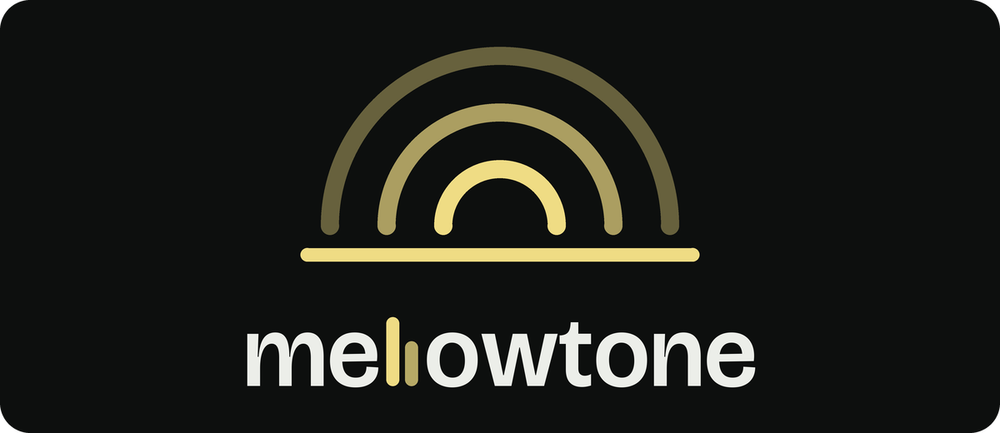

<p align="center">
  
</p>

Mellowtone is an open-source music player for hi-fi digital audio players,
written in C with [LVGL](https://lvgl.io/). It runs on HiBy players today
(see [Boards](#boards)), in place of the stock player. It has a
local library, gapless playback, equalizer, Bluetooth (LDAC, aptX, AAC, SBC),
Wi-Fi radio and Subsonic/DLNA streaming, lyrics, tag fixing, a web remote
control and Lua plugins.

## Boards

| Board | SoC | Status |
|---|---|---|
| HiBy R3 Pro | Ingenic X1000 | Main target, in daily use |
| HiBy R1 | Ingenic X1600 | Builds; not tested on hardware by this project |
| HiBy R3 Pro II | Ingenic X1600 | Builds; not tested on hardware |
| HiBy R3 II (2025) | Ingenic X1600 | Builds; not tested on hardware |

## Install

**R3 Pro.** Mellowtone installs on the writable `/data` partition over ADB;
nothing is flashed and the stock firmware stays in place. Holding Vol- at
power-on opens a recovery menu, and three failed starts fall back to the
previous version and then to the stock player. Later versions install from
an update package on the memory card. See
[`boards/r3pro/launcher/INSTALL.md`](boards/r3pro/launcher/INSTALL.md).

**X1600 boards.** These need a firmware image that you build yourself from
the official HiBy firmware: [`docs/FIRMWARE.md`](docs/FIRMWARE.md).

Installing third-party software on your player is at your own risk. Keep a
copy of the official firmware for your model so you can return to it.

## Build

Every build step runs in a container (Podman or Docker) through `./mt`:

```sh
./mt setup                 # build the container images once
./mt build r3pro           # or r1, r3proii, r3ii_2025: build/<board>/
./mt build host            # SDL simulator: build/host/mellowtone-host
./mt test                  # unit tests and the translation check
./mt i18n [check]          # regenerate / check translations
./mt image r3pro --stock <official r3pro.upt>   # R3 Pro firmware image
```

`./mt build <board>` gives `build/<board>/mellowtone-<board>` (the player)
and `build/<board>/mellowtone-launcher`.

## Documentation

- [`docs/ARCHITECTURE.md`](docs/ARCHITECTURE.md): how the player, UI, plugins and launcher fit together.
- [`docs/BUILDING.md`](docs/BUILDING.md): building with `./mt`, settings and outputs.
- [`docs/TOOLS.md`](docs/TOOLS.md): external tools and files the build needs.
- [`boards/r3pro/launcher/INSTALL.md`](boards/r3pro/launcher/INSTALL.md): installing on the R3 Pro over ADB.
- [`docs/FIRMWARE.md`](docs/FIRMWARE.md): firmware images for every board.
- [`docs/PLUGINS.md`](docs/PLUGINS.md): writing Lua plugins (examples in `examples/plugins/`).
- [`docs/PLAYER_LAYOUTS.md`](docs/PLAYER_LAYOUTS.md): the Now Playing XML layout.
- [`docs/REMOTE_CONTROL_API.md`](docs/REMOTE_CONTROL_API.md): the remote-control API.
- [`po/README.md`](po/README.md): translations.

## Bugs

Use the issue tracker. Attach the log from the memory card if you can, and
remove passwords and other private details from it first.

## Stock firmware and trademarks

Stock HiBy firmware files and graphics are proprietary and are never part of
this repository; build steps that need them take them from your own device
or the official firmware. Firmware images built from them contain HiBy's
software and must not be redistributed.

Mellowtone is an independent project, not affiliated with or endorsed by
HiBy Music. HiBy and the product names are trademarks of their owners and
are used here only to name the supported devices.

## License

Mellowtone is licensed under the [GNU General Public License, version 3](LICENSE).
It statically links [FAAD2](https://github.com/knik0/faad2) (GPL-2.0-or-later)
for AAC decoding and libdbus (AFL-2.1 or GPL-2.0-or-later, used under the
GPL); other dependencies (LVGL, dr_libs, tinyalsa, mbedTLS, Lua, cJSON, Opus,
libjpeg, ALAC, libexecinfo) use permissive licenses. Font licences:
[`assets/fonts/NOTICE.md`](assets/fonts/NOTICE.md).

Mellowtone is based on [Compás Player](https://github.com/Starnished66/compas-player)
(GPL-3.0) and has been modified from it since October 2026.
