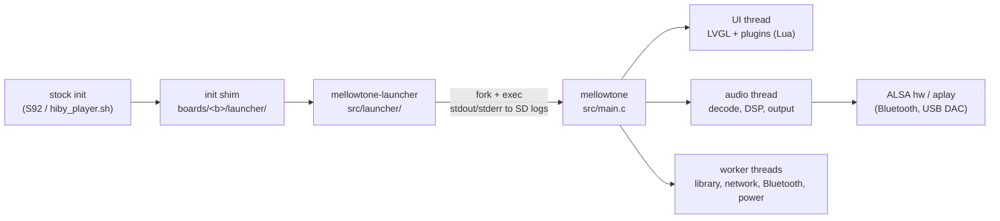
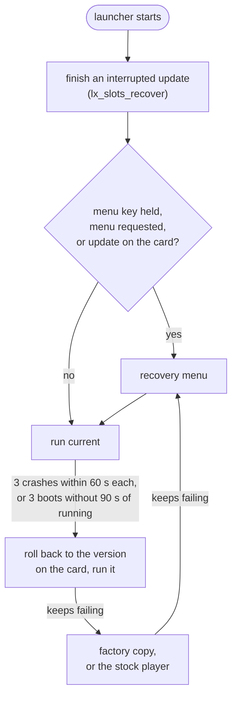

# Architecture

How Mellowtone is put together: the processes on the device, the board
abstraction, the player core, the UI, plugins and the launcher. It is a map
for finding your way in the code; the code and its comments have the details.
Building is in [BUILDING.md](BUILDING.md), the plugin API in
[PLUGINS.md](PLUGINS.md), installing in
[`boards/r3pro/launcher/INSTALL.md`](../boards/r3pro/launcher/INSTALL.md) and
[FIRMWARE.md](FIRMWARE.md).

## The big picture

Two programs of ours run on the player:

- **`mellowtone-launcher`**, a small static binary started by the stock init
  scripts. It starts the player, restarts it after a crash, falls back to an
  older version when the current one keeps failing, installs updates from the
  card and shows a recovery menu. It does not link LVGL or any player code.
- **`mellowtone`**, the player: one process with the LVGL UI, the audio
  engine, the library, networking and the Lua plugins.

Both run on top of the stock HiBy system, which stays in place: its kernel,
`sys_server`, Bluetooth and Wi-Fi scripts and drivers. Mellowtone replaces
only the stock player.

The same sources build for four boards and an SDL simulator on the PC:

| Preset | Board | SoC | Screen |
|---|---|---|---|
| `r3pro` | HiBy R3 Pro | Ingenic X1000, kernel 3.10, BlueZ 4 | 360×480 |
| `r1` | HiBy R1 | Ingenic X1600 | 480×800 |
| `r3proii` | HiBy R3 Pro II | Ingenic X1600 | 480×720 |
| `r3ii_2025` | HiBy R3 II (2025) | Ingenic X1600 | 320×480 |
| `host`, `host-minimal` | SDL simulator (R1 layout) | PC | 480×800 |

## Source tree

| Path | What |
|---|---|
| `src/main.c` | Player entry point, device init, the main loop |
| `src/core/` | Board descriptor, settings, storage paths, logging, the loop wake-up pipe, time zones, subprocesses, the launcher client |
| `src/audio/` | Decoders, the playback thread, DSP (EQ, ReplayGain), output targets, volume |
| `src/library/` | The tag database (tagcache), metadata and tag writing, album art, playlists, queue, lyrics, radio list |
| `src/network/` | `bluetooth/`, `wifi/`, `http/` (client, TLS, streams), `online/` (Subsonic, MusicBrainz, LRCLIB), `services/` (web remote, DLNA, AirPlay, sys_server bridge) |
| `src/hardware/` | `input/` (keys, headphone jack), `power/` (battery, charger, backlight, suspend), `usb/` (gadget modes, card lending, USB DAC) |
| `src/ui/` | Every screen, navigation, theme, fonts, translations |
| `src/plugins/` | The Lua plugin runtime |
| `src/launcher/` | The launcher, its recovery menu and board hooks |
| `boards/<board>/` | `board.c` (the descriptor), `board.cmake`, launcher shims, board artwork |
| `vendor/` | `lv_conf.h`, configuration headers for dependencies, the LVGL 9.4 XML engine |
| `patches/` | Patches to LVGL and the BlueZ 4 patch series |
| `cmake/` | Pinned dependency downloads, compile-time features |
| `tests/` | Host unit tests (`./mt test`) |
| `po/`, `tools/i18n/` | Translations and the catalog generator |

Dependencies (LVGL 9.5, dr_libs, tinyalsa, FAAD2, ALAC, Opus, mbedTLS, Lua,
cJSON, libjpeg, D-Bus, libexecinfo) are pinned archives downloaded at
configure time (`cmake/dependencies.cmake`), not kept in the tree.

## Boards

A board is described once, in `boards/<board>/board.c`, as the constant
`BOARD` of type `board_desc_t` (`src/core/board.h`). Code asks the
descriptor instead of testing for a board name. It has four kinds of content:

- **Capabilities**: what the hardware can do (`CAP_WIFI`, `CAP_USB_DAC`, …),
  tested with `board_has()`. A board can list a capability that is not
  implemented yet; `board_impl_missing()` hides its UI. Plugins see them as
  `hw.*` tokens.
- **Facts**: screen size, rotation and scale, input device names and the
  recovery-menu key, ALSA card and mixer names, power-supply nodes, paths
  (install root, SD root, theme root, fonts), Wi-Fi interface and scripts.
- **Quirks and flags** for behaviour that is not a capability, for example
  `BOARD_POWER_NO_SUSPEND`, `BOARD_POWER_BT_RESUME_SCRIPT`,
  `screen.no_fb_blank`, `ui.no_marquee`.
- **Back-end ops** chosen per board: Bluetooth platform (HiBy `sys_server`
  or scripts), USB gadget (`android_usb` on the R3 Pro, configfs on the
  X1600), card export for USB storage, charger, and the launcher hooks.

The board is chosen at build time: the CMake preset sets `MT_BOARD`, which
includes `boards/<board>/board.cmake` (its define, extra sources, LVGL
patches, feature presets). Screen-size constants and the scaling macros
(`BOARD_SCALE_PX`, `BOARD_UI_PX`, …) are in `src/core/board_config.h`; each
`board.c` checks its screen size against them at compile time.

**Compile-time features** are separate from capabilities: optional software
(`MT_FEATURE_AIRPLAY`, `MT_FEATURE_DLNA_RENDERER`, `MT_FEATURE_WIFI_IMPORT`,
`MT_FEATURE_REMOTE`, the Opus and WMA codecs, `MT_I18N`) switched in
`cmake/features.cmake`. A feature that is off drops its sources and leaves
stub headers; test with `MT_HAS_FEATURE(X)`. The R3 Pro turns AirPlay, the
DLNA renderer and Wi-Fi import off. `mellowtone --features` lists them.

## The player process

### Startup

`main()` in `src/main.c`, in order: crash handler, environment
(`LD_LIBRARY_PATH`, a writable `HOME` for ALSA), mounting the card where the
board does not do it itself, the state directories on the card, the HiBy
`sys_server` client, Bluetooth and Wi-Fi power as last saved, power events
and battery, `lv_init()` and the framebuffer, settings, the boot splash,
touch and key input, `audio_init()`, then `gui_init()` (`src/ui/gui.c`),
which builds the UI, loads plugins and the library cache, and restores the
queue.

`main` also has helper modes that run before any hardware is touched:
`--version`, `--features`, and `--metadata-artwork-helper`, the child
process that reads cover art in isolation.

### Main loop and wake-ups

The main thread runs `lv_timer_handler()` and then sleeps in
`loop_wake_wait()` until the next LVGL timer is due: at most 100 ms with the
screen on, 500 ms with it off, 10 s in quiet idle. `loop_wake_signal()`
(`src/core/loop_wake.c`, a self-pipe) lets any thread end that sleep early,
for example when a key is pressed. LVGL's tick is advanced by the loop
rather than by a clock callback, because each `clock_gettime` costs two
system calls on the R3 Pro's kernel.

The process never returns from the loop on the device. Power off and reboot
go through `src/core/idle_shutdown.c`; under the launcher a reboot is an
exit with `BOARD_LAUNCHER_EXIT_REBOOT` (75) so the launcher can release the
card first.

### Threads

**All LVGL and all Lua run on the main thread.** LVGL is built without OS
locking (`LV_USE_OS` is off), so no other thread may touch an LVGL object.

Everything slow runs on worker threads: the audio playback thread, library
scans, metadata and cover decoding, HTTP, Wi-Fi, Bluetooth, the web remote
and DLNA listeners, key input, power events, the USB DAC bridge. A worker
hands its result back by publishing it (an atomic flag or a mutex-guarded
slot) and, when it is urgent, calling `loop_wake_signal()`. The UI thread
picks it up in a timer:

- `update_timer_cb` in `gui.c`, every 500 ms (5 s in quiet idle), calls the
  `*_consume_*()` and `poll_*()` functions of each module: audio events
  (track advanced or finished, errors), Wi-Fi, Bluetooth, Subsonic, DLNA, USB,
  card hot-plug, cover decode, lyrics, search, plugins.
- Two fast timers drain the hardware keys (`hw_buttons_consume_*()`).
- Some screens run their own short timers (list fetches, the quick drawer).

Player state is polled this way rather than pushed; there are no LVGL
subjects or observers. `lv_async_call()` is used only on the UI thread, to
move work out of an event callback.

Locks are local to their module: `audio_mutex` and `audio_cond` for
playback state, the output's owner, config and state mutexes (no device I/O
under them), the metadata database guards, `bt_chip_mutex` for Bluetooth
chip actions. Most `bluetooth_control_*` calls block and must not be made
from the UI thread.

### Audio

`src/audio/audio.c` owns one playback thread for the life of the process.
The UI owns the queue: it calls `audio_play_file_at()` for a user action and
`audio_set_next_track()` to stage the next track, and learns what happened
through `audio_consume_*()`.

- **Decoders**, chosen by extension in `decoder_open_internal()`: FLAC, MP3
  and WAV (dr_libs), AIFF, DSF and DFF (DSD to PCM, or native DoP to the
  local DAC), AAC and M4A/M4B (FAAD2 or ALAC through `mp4_demux`), APE, WMA,
  Opus and Ogg Vorbis. An `http(s)://` URL or a `remote://` path opens a
  network stream (`src/network/http/http_stream.c`, a pump thread and a ring
  buffer) decoded as FLAC, AAC or MP3.
- **Gapless and crossfade** happen in the playback thread: the staged next
  track is opened before the current one ends; a 3 s crossfade is used when
  both tracks have the same rate and channels.
- **DSP**: ReplayGain (track or album), a parametric EQ (`peq.c`, biquads)
  with 10-band presets on top. There is no resampler: the local DAC reopens
  at the source rate, and Bluetooth and USB go through ALSA's `plug`.
- **Output targets** (`audio_output.c`): the local DAC through tinyalsa
  (`hw:` card and device from the board, output port and DoP set through the
  mixer); Bluetooth by piping PCM to `aplay` (BlueALSA on the X1600 boards,
  HiBy's ALSA plugin on the R3 Pro); an external USB DAC through
  `aplay -D plughw`; SDL audio on the host.
- **Volume**: the local DAC uses its hardware mixer through a volume worker,
  with the board's stock volume table, a plugin curve, or a built-in taper.
  USB, and Bluetooth without its own volume, use software gain. Slider moves
  are coalesced.
- **USB DAC mode** (a computer playing through the player) is separate:
  `src/hardware/usb/usb_dac_bridge.c` reads HiBy's `/dev/uac_sa` and writes
  into the output, after stopping file playback.

### Library

- **Database**: a POSIX port of Rockbox's tagcache in
  `<card>/.mellowtone/library/`, used only through `metadata_db.h`. A commit
  writes a complete new generation of the database files and switches to it
  atomically.
- **Metadata**: `metadata.c` reads tags for every format; risky parsers run
  in a forked child that is killed on a timeout, and cover art in a separate
  helper process with a memory ceiling. `tag_writer.c` writes FLAC and MP3
  tags (MusicBrainz tag fixing), with backups on the card.
- **Album art**: `albumart.c` (from Rockbox) finds the cover, `cover_decode.c`
  decodes JPEG, PNG and BMP, `image_thumb.c` writes thumbnails, all cached on
  the card.
- **Also**: playlists (`.m3u`), the saved queue, favourites, CUE sheets,
  `.lrc` lyrics, the radio list (`Radio.txt`), the file browser.

The scanner that walks the card and feeds the database runs in threads
started from `src/ui/gui_library.c`, not from `src/library/`.

### Storage

Mellowtone writes almost nothing to flash. `src/core/storage_paths.h` has
every path.

| Where | What |
|---|---|
| Install root on flash: `/data/mellowtone` (R3 Pro) or `/usr/data` | The player, fonts, theme, ALSA config, base `Radio.txt`; written only by installs and updates |
| Image root: `/usr/mellowtone` (firmware-image installs) | The factory copy and read-only resources |
| `<card>/.mellowtone/config/` | `settings.txt` and the other settings files |
| `<card>/.mellowtone/library/`, `cache/` | The database, the saved queue, art and other caches |
| `<card>/.mellowtone/logs/` | All logs, including `player.out` from the launcher |
| `<card>/.mellowtone/plugins/`, `plugin-data/` | Plugins and their storage |
| `<card>/.mellowtone/update/`, `backup/` | Update packages, the previous version, tag and settings backups |

`settings.txt` holds `key=value` lines and is written with mode 0600, since
it contains the Subsonic password and the remote-control PIN. Every state
write goes through `mt_state_prepare_write()`, which refuses when there is no
writable card or the card is lent to a computer; such a save is retried when
the card is back. Files are replaced atomically (temporary file, fsync,
rename, directory fsync).

### Network and hardware services

| Module | Responsibility |
|---|---|
| `network/bluetooth/` | `bluetooth_control.h` on top of three back ends picked at run time: the stack (BlueZ 4 or 5 over D-Bus), the platform (HiBy `sys_server` or scripts), the audio transport (HiBy plugin or BlueALSA). Also AVRCP, reconnect, per-device codec choice, the RFCOMM remote |
| `network/wifi/` | One worker on the `wpa_supplicant` control socket; the UI reads a cached state |
| `network/http/` | HTTP client, sockets with a DNS thread, TLS (mbedTLS and a bundled CA list), live streams |
| `network/online/` | Subsonic, MusicBrainz (one request per second), LRCLIB lyrics |
| `network/services/` | The web remote and JSON API (port 8899, [REMOTE_CONTROL_API.md](REMOTE_CONTROL_API.md)), DLNA client and renderer, AirPlay, Wi-Fi import, the `sys_server` bridge |
| `hardware/input/` | Key events from evdev on their own thread, headphone detection |
| `hardware/power/` | Power events, battery, charger and charge limits, backlight, suspend to RAM |
| `hardware/usb/` | USB modes (charge, storage, DAC, ADB), lending the card, the USB DAC bridge |

## The UI

`src/ui/`, about 66,000 lines on LVGL 9.5.

### LVGL on the device

- **Display**: LVGL's Linux framebuffer driver in direct mode with two
  buffers, 16-bit colour (the R3 Pro's framebuffer is 32-bit).
  `patches/lvgl_fbdev_compositor.patch` uses the framebuffer's two pages as
  LVGL's buffers and flips between them. The R3 Pro's smart LCD needs
  `patches/lvgl_r3pro_slcd_pan.patch`: it waits for each transfer, writes
  both pages and can put the panel to sleep. The simulator uses SDL.
- **Input**: touch is an LVGL evdev pointer (found by name, calibration
  flipped on 180° panels). Hardware keys are not an LVGL input device: a
  thread in `hardware/input/hw_buttons.c` reads them and UI timers drain
  them.
- **Screen off and sleep** (`gui.c`): the screen dims, then turns off; LVGL
  stops refreshing and reading input. On the R3 Pro the panel sleeps through
  the framebuffer driver and the backlight goes to 0 instead of blanking,
  and 60 s after the screen goes off with playback paused on battery the
  player suspends to RAM (`power_suspend.c`): Bluetooth and Wi-Fi go down
  first and are brought back on a thread after the wake.

### Screens and navigation

- Most screens are built once by `gui_init()`; a few are built on first
  use (Radio, the streaming home). Shared builders are in
  `screen_builders.c`: list screens, icon grids, a virtualized list for long
  lists, headers, popups.
- `gui_navigation.c` keeps a stack of up to 16 screens. `nav_push()` loads
  a screen at once; `nav_pop()` slides back. Back comes from the header
  button, a right swipe, or the interactive swipe tracked by `gui_shell.c`.
  Transitions slide snapshots of the two screens; on the X1600 boards
  `transition_compositor.c` draws them straight into the framebuffer.
- The status bar, quick drawer and home indicator live on LVGL's top layer
  (`gui_shell.c`).
- `gui_reload.c` rebuilds every screen without stopping playback. Plugin
  changes and theme changes use it.

| Area | Files |
|---|---|
| Home (clock face, four shortcuts) | `gui_home_clock.c` |
| Music library, search | `gui_library.c` |
| Now Playing | `gui_player.c`, `player_layouts.c` (XML layout, [PLAYER_LAYOUTS.md](PLAYER_LAYOUTS.md)), `gui_now_panel.c`, `gui_queue.c`, `gui_lyrics.c` |
| Streaming, radio | `gui_stream_home.c`, `gui_subsonic.c`, `gui_radio.c` |
| Wireless hub | `gui_network.c` with `gui_wifi.c`, `gui_bluetooth.c`, `gui_usb.c`, `gui_remote.c`, `gui_dlna.c`, `gui_airplay.c` |
| Settings | `gui_settings.c`, `gui_settings_playback.c` |
| First-run setup | `gui_setup.c` |
| Tag fixing | `gui_retag.c` |
| Text entry and text pages | `gui_text_input.c` (T9 keypad), `gui_text_view.c` |
| Plugin screens | `gui_plugins.c`, `gui_plugin_manage.c` |

### Theme, fonts, translations

- **Assets**: `asset_path()` (`assets.c`) looks in
  `<install root>/theme_overrides/` first, then in the board's theme root. On
  the X1600 boards that is the stock theme with our files copied over it; on
  the R3 Pro it is `<install root>/themes`.
- **Colours**: shared styles that plugins can recolour, and an accent colour
  (16 choices, or matched to the album art).
- **Fonts** (`fallback_font.c`): Montserrat in three size tiers, scaled per
  board, with fallbacks rendered by tiny_ttf for CJK, Cyrillic, Korean, Thai,
  Hebrew and emoji. Fallbacks load from disk shortly after start.
- **Translations**: English text is the key (`TR()`, `TR_N()`, `N_()`,
  `TR_C()`). `tools/i18n/po2c.py` compiles `po/*.po` into `i18n_catalog.c`;
  `./mt i18n` regenerates it ([`po/README.md`](../po/README.md)).

### Per-board differences

Layouts are designed at 480×800 (older screens, `BOARD_SCALE_PX`) or 360×480
(newer screens, `BOARD_UI_PX`) and scaled. The R3 Pro also sets `no_marquee`
(long text ends in "…" instead of scrolling) and other `BOARD.ui` flags.

## Plugins

`src/plugins/plugin_manager.c` is the whole Lua runtime; the user-facing API
is in [PLUGINS.md](PLUGINS.md).

- **Loading**: `<card>/.mellowtone/plugins/*.lua`, in byte-wise alphabetical
  order, at most 32 enabled. Each plugin gets its own `lua_State` for the
  whole session (its callbacks are references into it). A plugin that fails
  to load is rolled back completely: its registrations, its volume curve,
  its LED override.
- **Reload**: there is no unloading of a single plugin. Enabling, disabling,
  "Refresh Plugins" and `plugin.reload_ui()` all request a full reload
  (`gui_reload.c`): screens are torn down, every Lua state closed, plugins
  loaded again, then screens rebuilt, because screens copy plugin rows and
  tiles when they are built.
- **Threads**: Lua runs only on the UI thread, called from LVGL events and
  timers and from `plugin_manager_poll()` in the 500 ms update timer.
  Asynchronous HTTP requests (up to 4) and thumbnails run on worker threads
  and deliver their results through `plugin_manager_poll()`. Storage and file
  access are synchronous.
- **Time limit**: `plugin_call()` sets a Lua count hook. After 2 s of Lua
  time it raises an error the plugin can catch; after 3 s it aborts the call
  and freezes that plugin until the next reload. Time spent in native calls
  is not counted.
- **Sandbox**: `load`, `require`, `debug`, `os.execute`, `io.popen` and
  others are removed; file functions are wrapped. Plugins cannot touch the
  settings folder or other plugins' data, and cannot write to the install
  root. Each plugin has its own `plugin.storage` and `plugin.secrets`
  (`plugin_storage.c`), with quotas. Capability tokens report what the
  player has; they are not permissions.
- **Extension points**: rows in 11 native lists, Stream Media tiles, quick
  drawer toggles, plugin screens (lists, settings lists, details, text
  pages, text input), theme icons and colours, events (`track_started`,
  `paused`, `volume_changed`, `suspending`, …), a hardware volume curve, the
  layout of the main menus.

## The launcher

`src/launcher/`, a separate static binary (see [The big
picture](#the-big-picture)). It shares only libc-level code with the player:
the board hooks and a few core files.

### Starting the player

The stock init starts a shim (`boards/<board>/launcher/`), which runs
`/data/mellowtone/current/mellowtone-launcher`, falling back to a second copy
and then to the factory or stock player. The launcher paints the boot logo,
waits for the card, opens the menu if the board's menu key is held (Vol- on
the R3 Pro), and starts the player with its output in
`<card>/.mellowtone/logs/player.out`. The player dies with the launcher, so
two players never share the hardware.

- A crash restarts the same version after 1 s. Three crashes within 60 s of
  starting move to the next level.
- A boot counter in `/data/mellowtone-boot/` catches crashes that reboot the
  device: it counts starts and is cleared after 90 s of running. At 3 the
  launcher starts with the previous version. There is no explicit "started
  fine" message from the player; 90 s of running is the signal.
- The player can ask for the menu (`launcher_request_menu()` writes a flag,
  then the player exits with 75), and receives a one-time notice such as
  "rolled back" in `MELLOWTONE_NOTICE`.

### Versions and updates

Flash holds one version, `/data/mellowtone/current/`. The previous one is
kept on the card in `.mellowtone/backup/player/`, so an update needs room in
flash only for the new version (`lx_slots.c`, design notes in `lx_update.h`).

- **Update package**: `.mellowtone/update/mellowtone-<board>-<version>.tar`, a
  tar with a `MANIFEST` of SHA-256 checksums, made by
  `tools/release/make_update_package.sh`. Every checksum is verified before
  anything changes (`lx_pkg.c`).
- **Install**: copy current to the card and read it back (checked), write a
  journal, remove current, unpack the package, make it current, remove the
  journal. **Roll back** swaps current and the card copy the same way.
- **Power cuts**: every step is a rename followed by a directory sync, and
  `lx_slots_recover()` finishes or undoes an interrupted install or roll back
  at the next start. `current/` is removed by renaming it first, so a
  `current/` that exists is always complete.

### Recovery menu

`lx_menu.c` draws straight to the framebuffer (`lx_fb.c`, a bitmap font, no
LVGL) and reads keys and taps from evdev. Items: start, install a player
update, install a firmware image (`lx_fw.c` checks the image and its board
before handing it to the stock updater), roll back, start the factory or
stock player, enable ADB, reset settings, device info, reboot, power off.

### Board hooks

`src/launcher/hooks/` holds two sets of ops (`board_launcher.h`): the R3 Pro
(X1000) forces USB device mode and keeps ADB alive, syncs the clock, and
enters the stock updater through `/proc/jz/reset/reset`; the X1600 boards
mount the card themselves, use `bootmode.sh` for the updater, and release
the card before a reboot.

## Tests

`./mt test` builds the `host` preset in the build container and runs `ctest`
(`tests/CMakeLists.txt`): the tag database, the plugin runtime, Bluetooth
against a mock BlueZ, Wi-Fi, power, USB and the USB DAC bridge, HTTP,
MusicBrainz with fixtures, tag writing (partly as root), every board's
descriptor, the launcher (with a fake platform and a simulated power cut at
every step of an install and a roll back), the update-package script, and
the translation check.

## Known rough edges

Worth knowing before you change these areas:

- The library scanner lives in the UI layer (`gui_library.c`), not in
  `src/library/`.
- `settings_load()` runs twice at start on the device (`main.c` and
  `gui_init()`).
- On the X1600 boards a settings reset reboots directly
  (`settings_factory_reset()`), not through the launcher, which would release
  the card first.
- The Stream Media icon screen is still built, but nothing opens it any
  more; Home's Stream shortcut opens the streaming home. Tiles added with
  `plugin.register_stream_media_tile()` are on that screen, so users cannot
  reach them at the moment.
- `MUSIC_ROOT_DIR` is defined separately in several files.
